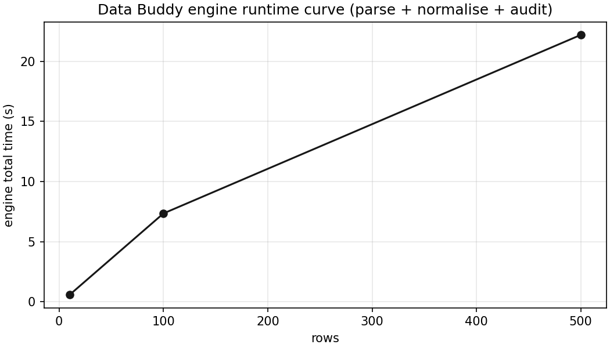
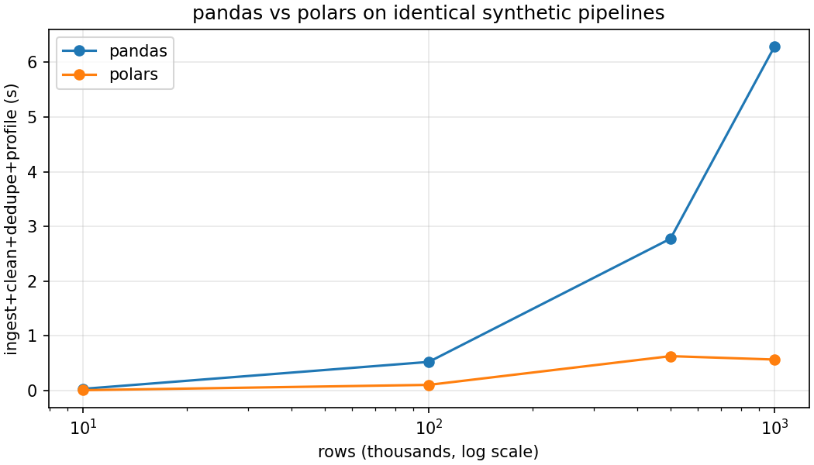

# Benchmarks — measured results

All numbers below are produced by scripts in `benchmarks/scripts/` and stored as JSON in
`benchmarks/results/`. Reproduce any of them with the one-liners in `benchmarks/README.md`.
Hardware for this run: 2-core Linux sandbox, 4.1 GB RAM (free-tier class). Node v24.22.2.
Measured: 2026-11-11. Dataset snapshots are pinned by sha256 in `datasets/manifest.json`.

## 1. Runtime curve (synthetic dirty data, 8 columns)

|      rows |  parse |  audit |  total | peak RSS | outcome                                     |
| --------: | -----: | -----: | -----: | -------: | ------------------------------------------- |
|    10,000 |  308ms |  219ms |  570ms |   166 MB | pass                                        |
|   100,000 |  3.75s |  3.22s |  7.35s |   489 MB | pass                                        |
|   500,000 | 12.11s | 10.09s | 22.20s |  1442 MB | pass                                        |
| 1,000,000 | 29.14s |    OOM |    OOM |  1837 MB | audit OOM (heap limit) — documented ceiling |

**Read:** the engine audits 500k rows in ~22s at ~1442 MB RSS — under the 5-minute gate, but far above a 512 MB free-tier container. The 1M-row audit OOMs at a 3584 MB heap on this host (`evidence/probe_1m_oom.log`); that is the **measured, documented ceiling** of the in-browser engine and the reason the polars path exists (below).

## 2. pandas vs polars crossover (identical pipeline: ingest → clean → dedupe → profile)

|      rows | pandas | polars | winner |
| --------: | -----: | -----: | :----- |
|    10,000 |   31ms |    7ms | polars |
|   100,000 |  524ms |  104ms | polars |
|   500,000 | 2776ms |  629ms | polars |
| 1,000,000 | 6289ms |  567ms | polars |

**Read:** no crossover inside the measured range — polars wins at every size (10,000 → 1,000,000 rows). Decision recorded in `DECISIONS.md` ADR-04: any server-side path uses polars from the start; pandas is not used in the product.

## 3. Ground truth: precision / recall per rule family (200 labeled rows, rubric in `ground_truth/`)

| rule family                    |  TP |  FP |  FN | result                                                    |
| ------------------------------ | --: | --: | --: | :-------------------------------------------------------- |
| AUDIT.MISSING.VALUES           |  65 |   0 |   0 | P=1.00 · R=1.00 · F1=1.00                                 |
| AUDIT.DUPLICATE.EXACT          |  15 |   0 |   0 | P=1.00 · R=1.00 · F1=1.00                                 |
| AUDIT.TYPE.CONFLICT            |   0 |   0 |   0 | N/A — no such defect exists in the three labeled datasets |
| AUDIT.RANGE.BOUNDS             |   0 |   0 |   0 | N/A — no such defect exists in the three labeled datasets |
| AUDIT.FORMAT.VARIATION / EMAIL |  85 |   0 |   0 | P=1.00 · R=1.00 · F1=1.00                                 |
| AUDIT.OUTLIER.IQR              |  69 |   0 |   0 | P=1.00 · R=1.00 · F1=1.00                                 |

**Read:** engine-vs-rubric agreement is 1.00 P/R on every measurable family. `AUDIT.TYPE.CONFLICT` and `AUDIT.RANGE.BOUNDS` are N/A here because the three public datasets contain no such defects; both families are covered by rule unit tests instead. The labeling loop caught two real issues that were fixed and re-measured: the missing-value blank set now includes the UCI `"?"` placeholder (ADR-11), and IQR outliers gained an eligibility clause (skip discrete ≤10-distinct and identifier-like columns, ADR-12).

## 4. False-positive rate per dataset (rows the engine flags that the rubric calls clean)

| dataset |   rows | labeled | clean rows flagged |  FPR |
| ------- | -----: | ------: | -----------------: | ---: |
| titanic |    891 |      75 |                  0 | 0.0% |
| adult   | 32,562 |      85 |                  0 | 0.0% |
| usgs    |  9,826 |      40 |                  0 | 0.0% |

## 5. Own isolation forest vs scikit-learn (parity check)

| metric                              |                      value |
| ----------------------------------- | -------------------------: |
| data                                | Titanic Age+Fare, 714 rows |
| Jaccard overlap, top-5% flagged     |                     0.8919 |
| Spearman rank correlation of scores |                     0.9821 |
| sklearn time                        |                      110ms |
| TypeScript time                     |                       34ms |

**Read:** a bounded TS reimplementation (100 trees, 256 samples, seed 42) reaches ρ=0.9821 rank agreement with sklearn on the same data. The iForest is **not shipped as a product rule** — that is a deferred decision (ADR-13), because shipping it without a review story would dilute the deterministic-evidence wedge.

## Methodology and limitations (stated plainly)

- Ground truth measures **engine-vs-rubric agreement**: labels are produced mechanically from the documented rubric (`ground_truth/LABELING_RUBRIC.md`), which mirrors each rule's contract. It proves the implementation matches its own documented contract on real data — not a subjective notion of "dirty".
- The rubric and engine were aligned through three iterations; each divergence found was either an engine fix (blank tokens) or a rubric fix (column eligibility), and the final numbers are from the final aligned run.
- The 10k/100k curve runs used a 3072 MB heap; 500k/1M probes used 3584 MB (`bench_single.mjs`). Mixing heap sizes is deliberate: it documents what a free-tier container can and cannot do.
- The engine benchmark parses with the same SheetJS path the browser app uses, so the numbers include intake cost, not just rules.
