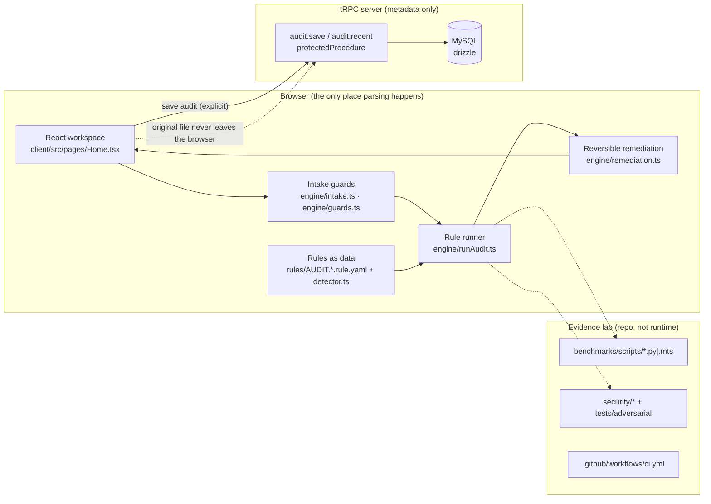

# Architecture

## The three moves that matter

1. **Parse in the browser, keep the bytes.** The original file is never
   uploaded and never stored; the server only ever receives audit _metadata_
   the user explicitly saves. Privacy and the never-mutated promise share one
   mechanism.
2. **Rules are data, findings are contracts.** `rule.yaml` declares severity,
   repair, and the evidence fields a finding must carry; `dbuddy rules lint`
   fails the build if a rule cannot produce evidence. The runner computes
   column values once, feeds every detector the same context, and sorts
   findings deterministically (severity → affected count → rule ID).
3. **Everything hostile is bounded before it runs.** `engine/guards.ts`
   rejects or samples row bombs, column bombs, cell bombs, and workbook
   dimension bombs with named `SafeRejection` codes that the UI renders as a
   designed state. Cell text is data everywhere: the audit path contains no
   eval, no model calls, and no DOM injection.

## Where the numbers come from

The benchmark lab imports the same `runRuleAudit` + registry the browser
uses, so measured runtime includes the real intake path (SheetJS parse →
normalise → audit). Polars/pandas and sklearn comparisons run in Python
against identical data and are pinned by dataset sha256s. See
`benchmarks/RESULTS.md` for curves and `DECISIONS.md` for the decisions the
measurements forced.
